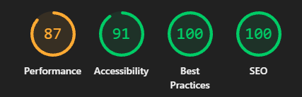
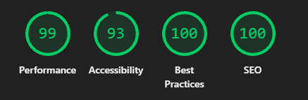

# Kurio — desafio frontend Jungle Gaming

Marketplace demonstrativo de NFTs, com catálogo responsivo, conta de colecionador, carrinho persistente e criação de pedidos. A API REST é simulada pelo MSW no navegador; um servidor Node separado oferece Socket.IO para os cenários locais de realtime. Não há pagamento, transferência de NFTs ou conexão real com blockchain.

**Resultados informados para a entrega: lint e build aprovados; 48/48 testes E2E aprovados.** Esta revisão é exclusivamente documental: não houve nova execução de testes, build, lint ou Lighthouse.

As decisões, os contratos e as limitações estão em [ARCHITECTURE.md](ARCHITECTURE.md). A documentação considera o código atual e a matriz de requisitos existente em `reports/acceptance-audit/matrix.json`; o enunciado integral não está no repositório. Relatórios em `reports/` são artefatos locais ignorados pelo Git e podem não acompanhar um clone.

## Stack

- React 19 e TypeScript 6 com modo estrito; Vite 8 para desenvolvimento e build.
- TanStack Router para rotas e parâmetros de busca; TanStack Query 5 para consultas, mutações e cache.
- Axios para REST; MSW 3 para interceptação de rede e persistência demonstrativa em `localStorage`.
- Socket.IO 4 no cliente e no servidor Node.
- Tailwind CSS 4, componentes shadcn/ui e Radix UI; ícones Lucide e React Icons.
- Playwright para E2E e regressão visual; Node Test Runner para API, domínio e realtime; ESLint e Lighthouse.

As versões exatas das dependências estão em `package-lock.json`.

## Funcionalidades

- Home com carrossel, destaques editoriais e catálogo de 24 NFTs.
- Busca, filtros por coleção/rede/preço, abas, ordenação e paginação persistidos na URL em `/` e `/mercado`.
- Detalhe em `/nft/:nftId`, galeria, informações, escolha de edição e quantidade; tratamento de NFT inexistente.
- Cadastro, login, logout e sessão com validade de 30 minutos para novos logins.
- Favoritos por conta, com atualização otimista e reversão em caso de falha.
- Carrinhos armazenados por conta e visitante; mesclagem do carrinho visitante ao autenticar, quantidades de 1 a 99 e cupom `KURIO10` de 10%.
- Perfil com avatar e troca de senha; cadastro, edição, remoção e seleção de carteira principal.
- Checkout autenticado com carteira cadastrada ou endereço manual; criação idempotente de pedido **pendente**, preservando o carrinho.
- Recuperação do pedido por URL e após recarregar; confirmação ou recusa manual via endpoint de desenvolvimento.
- Eventos de disponibilidade de NFTs e notificações de pedidos via Socket.IO, com deduplicação, versões e reconciliação REST no ambiente de desenvolvimento.

Rotas privadas: `/perfil`, `/carteiras`, `/checkout` e `/pedido/confirmacao`. Login e cadastro ficam em `/entrar` e `/cadastro`. A lista de pedidos abre em `/pedido/confirmacao`; `?orderId=<ID>` abre um pedido específico.

## Instalação e execução

Use Node.js 22.12 ou superior, npm e um navegador com service workers, Web Crypto e armazenamento local habilitados. Os scripts realtime executam TypeScript com `--experimental-strip-types`. O navegador deve acessar a aplicação por localhost ou HTTPS.

```sh
npm ci
npm run dev
```

Abra a URL informada pelo Vite. Para iniciar frontend e relay Socket.IO juntos:

```sh
npm run dev:full
```

Esse script fixa o frontend em `http://localhost:5173` e inicia o relay, por padrão, em `http://127.0.0.1:3001`. Se a porta 5173 estiver ocupada, o frontend não escolhe outra porta. O MSW inicia antes do React, inclusive no build de demonstração.

## Comandos

- `npm run dev`: servidor Vite.
- `npm run dev:realtime`: apenas o servidor Socket.IO.
- `npm run dev:full`: frontend e Socket.IO no mesmo comando.
- `npm run realtime:simulate -- <comando>`: comandos locais de disponibilidade/reconexão; exemplos abaixo.
- `npm run build`: verificação TypeScript com `tsc -b` e build Vite em `dist/`.
- `npm run preview`: serve o build localmente; execute `build` antes.
- `npm run lint`: ESLint do projeto.
- `npm run test:api`: testes Node da API simulada.
- `npm run test:realtime`: testes Node do relay e da integração realtime.
- `node --test tests/p0.test.mjs`: verificações adicionais de isolamento, sessão e contrato monetário.
- `npx playwright test`: suíte E2E e visual configurada em `playwright.config.ts`.
- `npx playwright show-report`: abre o relatório HTML gerado pelo Playwright.

Não há scripts npm chamados `test`, `test:e2e`, `deploy` ou `lighthouse`.

## Variáveis de ambiente

O arquivo [.env.example](.env.example) lista os valores locais principais. Para personalizar o frontend, copie-o para `.env.local` e reinicie o Vite. As variáveis `VITE_*` são públicas e incorporadas ao build.

- `VITE_REALTIME_URL`: URL do relay. Sem valor, usa `http://127.0.0.1:3001` em desenvolvimento e a origem do frontend no build. Apesar do comentário antigo em `.env.example`, o provider também tenta conectar em produção.
- `REALTIME_PORT`: porta do relay; padrão `3001`.
- `PORT`: alternativa de hospedagem, com prioridade sobre `REALTIME_PORT` no servidor.
- `REALTIME_ORIGINS`: origens permitidas, separadas por vírgula. Padrões locais: `http://localhost:5173,http://127.0.0.1:5173`. Obrigatória quando `NODE_ENV=production`.
- `REALTIME_DATA_FILE`: arquivo de persistência dos eventos públicos; padrão `.realtime/availability.json`, relativo à raiz de execução.
- `REALTIME_URL`: destino da CLI `realtime:simulate`; sem valor, usa `http://127.0.0.1:<REALTIME_PORT ou 3001>`.
- `NODE_ENV=production`: desabilita `/dev/command`, exige origens explícitas e faz o relay escutar em `0.0.0.0`.

Os scripts Node **não carregam `.env`/`.env.local` automaticamente**. Defina suas variáveis no terminal ou na plataforma de hospedagem. Exemplo em PowerShell:

```powershell
$env:REALTIME_PORT = '3001'
$env:REALTIME_ORIGINS = 'http://localhost:5173,http://127.0.0.1:5173'
npm run dev:full
```

Não há chave de API, URL REST externa ou seletor de cenários MSW por variável de ambiente. A base REST é `/api` e os mocks ficam sempre ativos.

## Credenciais fictícias

Não existe conta pré-cadastrada em uma base nova. Crie as contas em `/cadastro` antes de usar `/entrar`. Exemplos válidos para avaliação:

- Conta A: usuário `collector_a`, e-mail `collector-a@example.test`, senha `JungleTest123!`.
- Conta B: usuário `collector_b`, e-mail `collector-b@example.test`, senha `JungleTest123!`.

Esses exemplos não são credenciais provisionadas. Os testes também cadastram suas próprias contas. O usuário aceita letras, números, `_` e `-`, com 3 a 30 caracteres; a senha aceita 8 a 128 caracteres. Use apenas dados fictícios: a autenticação e os hashes permanecem no navegador e não oferecem segurança de backend.

Para testar o formato de uma carteira Ethereum/Polygon, pode-se usar `0x1111111111111111111111111111111111111111`. Isso não conecta uma carteira nem comprova propriedade ou saldo. Google e Facebook estão desabilitados.

## Cenários MSW e reset

Os handlers em `src/mocks/handlers/` simulam REST de forma persistente. As chamadas devem ocorrer no contexto da página controlada pelo service worker; `curl` contra o Vite não executa esses handlers.

1. **Base inicial:** uma origem limpa apresenta 24 NFTs e três linhas no carrinho visitante: `042` × 2, `314` × 6 e `088` × 9, edição `1/50`.
2. **Catálogo vazio/404:** busque um termo inexistente ou abra `/nft/nao-existe` para conferir vazio, erro e recuperação.
3. **Validação e autenticação:** senha incorreta retorna 401; cadastro com e-mail existente retorna 409; acessar rotas privadas sem sessão encaminha ao login. Novas sessões expiram após 30 minutos.
4. **Carrinho e cupom:** aplique `KURIO10`, remova o cupom ou use um código inválido para obter 400. Quantidade fora de 1–99 também retorna 400. Recarregue para verificar persistência.
5. **Isolamento:** cadastre A, favorite um NFT, saia e cadastre B. Favoritos, perfil, carteiras e pedidos pertencem à conta; o carrinho visitante é mesclado ao entrar.
6. **Pedido pendente:** preencha o checkout e envie. O POST retorna 201 com `status: "pending"`; recarregar a URL recupera o pedido por GET sem criar outro. Não há aprovação automática de pagamento.
7. **Falha de armazenamento:** o cenário em `tests/e2e/p0.spec.ts` provoca falha de quota, observa 503 e verifica rollback de favorito e recuperação após reload. Não existe botão de ativação desse cenário na aplicação.

Para confirmar manualmente um pedido pendente, em **desenvolvimento**, abra sua URL `/pedido/confirmacao?orderId=...` autenticado e execute no console do navegador:

```js
const orderId = new URLSearchParams(location.search).get('orderId')
const response = await fetch(`/api/orders/${encodeURIComponent(orderId)}/status`, {
  method: 'PATCH',
  headers: { 'Content-Type': 'application/json' },
  body: JSON.stringify({ status: 'confirmed' }),
})
console.log(response.status, await response.json())
```

Recarregue para consultar o estado persistido. Use `declined` no lugar de `confirmed` em **outro pedido ainda pendente** para simular recusa. O endpoint é indisponível no build/preview e não há controles de pagamento na interface para acioná-lo.

Com `npm run dev:full` ativo, execute em outro terminal os cenários de Socket.IO:

```sh
npm run realtime:simulate -- set 042 "1/50" false
npm run realtime:simulate -- duplicate 042
npm run realtime:simulate -- old 042
npm run realtime:simulate -- disconnect
npm run realtime:simulate -- set 042 "1/50" true
```

O primeiro comando torna a edição indisponível; os seguintes reenviam evento duplicado, versão antiga, interrompem conexões e restauram a disponibilidade. O comando `set` aceita ainda `nft:updated` como último argumento. O transporte é Socket.IO real, não uma simulação de Socket.IO pelo MSW.

**Reset local:** encerre o relay e feche as demais abas do Kurio. No armazenamento do navegador, remova as chaves com prefixo `kurio:` da origem utilizada, incluindo as legadas; remova também o arquivo indicado por `REALTIME_DATA_FILE` se quiser reiniciar as versões/disponibilidades do relay. Reinicie os serviços e recarregue a página. Isso apaga contas, sessão, carrinhos, favoritos, carteiras e pedidos locais e restaura a base inicial. Não há endpoint ou botão de reset. Protocolo, host, porta e perfil de navegador diferentes possuem bases independentes.

Não foram implementados seletores MSW de lentidão, offline, timeout após criação de pedido ou cupom expirado. Consulte as limitações em [ARCHITECTURE.md](ARCHITECTURE.md).

## Testes e validação

**48/48 testes E2E aprovados**, conforme o resultado informado para esta entrega, além de **lint e build aprovados**. Esses resultados não foram reexecutados nesta revisão. Os relatórios antigos de auditoria/P0 registram etapas anteriores e não representam a contagem final.

A configuração principal executa Chromium desktop (1440 × 900) e mobile (390 × 844). Os arquivos em `tests/e2e/` cobrem navegação, catálogo, autenticação, favoritos, carrinho, checkout pendente, recuperação de pedido, expiração de sessão, rollback e histórico da URL. Há snapshots de Home, detalhe, carrinho e checkout, com baselines Windows. Essas comparações verificam regressão em relação às baselines do projeto, não equivalência com o Figma.

Para uma execução futura, instale o navegador Playwright e rode:

```sh
npx playwright install chromium
npx playwright test
npx playwright show-report
```

O runner inicia o Vite automaticamente e permite reutilizar servidor existente fora de CI. Gera relatório HTML em `playwright-report/`, screenshots nas falhas e traces retidos nas falhas. `playwright.audit.config.ts` e `playwright.p0.config.ts` direcionam evidências a `reports/`. Os testes E2E não iniciam o relay; a cobertura Socket.IO disponível está nos testes Node. A aprovação da suíte não atesta todos os requisitos da matriz.

## Resultados Lighthouse

Auditoria mobile previamente informada: **Performance 87, Acessibilidade 91, Boas Práticas 100 e SEO 100**. Nenhuma medição foi executada nesta revisão. Os prints mobile e desktop estão disponíveis abaixo; não são atribuídas novas pontuações ao desktop.





## Build e deploy

Frontend publicado na **Netlify**: [acessar Kurio](https://kurio-realtime.netlify.app/). O servidor Socket.IO está hospedado no **Render**, conforme confirmado para a entrega; sua URL não foi fornecida nesta documentação. Esta revisão não executou validação funcional do ambiente publicado.

Para conferir o build local:

```sh
npm run build
npm run preview
```

Para hospedar a demonstração estática, configure instalação com `npm ci`, build com `npm run build` e publicação de `dist/`. Use HTTPS, mantenha `mockServiceWorker.js` na raiz publicada e configure fallback das rotas da SPA para `index.html`, preservando arquivos estáticos. O projeto usa caminhos absolutos e pressupõe hospedagem na raiz do domínio.

O relay exige um processo Node separado, as dependências instaladas e os fontes `server/` e `src/` importados por ele; não está contido em `dist/`. No Render, configure `NODE_ENV=production`, `REALTIME_ORIGINS=https://kurio-realtime.netlify.app`, `PORT`/`REALTIME_PORT` e armazenamento gravável para `REALTIME_DATA_FILE`; inicie com `npm run dev:realtime`. Na Netlify, `VITE_REALTIME_URL` deve apontar para a URL HTTPS real do serviço Render antes do build. Essas são as configurações exigidas pelo código; os valores dos painéis de hospedagem não foram inspecionados nesta revisão.

**Limitação do código atual em produção:** o cliente tenta conectar ao Socket.IO no build, mas a ponte MSW `POST /api/realtime/events` e a alteração de status de pedido retornam 404 fora de desenvolvimento. Hospedar o relay no Render não remove esses bloqueios. O REST demonstrativo permanece local ao navegador, e novos pedidos permanecem pendentes.
